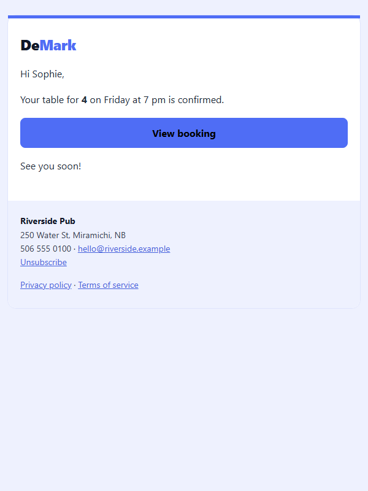
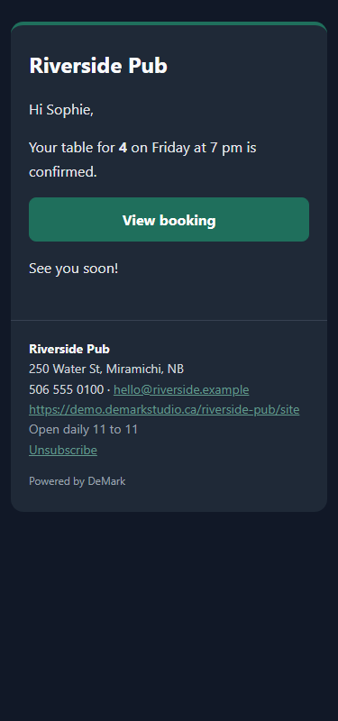

# html-email-lint

Lint HTML emails **the way real mail clients will treat them** (Gmail, Outlook for Windows, Outlook.com, Apple Mail) before you send, with no dependencies.

A browser preview says nothing about what Gmail clips, what Outlook's Word engine ignores, or which link still points at your dev server. This checks the file itself, `.html` or `.eml`, and says which client is affected and where that claim comes from.

```
python -m html_email_lint emails/ --format json --output report.json
python -m html_email_lint welcome.eml --fail-on warning
python -m html_email_lint confirmation.html --screenshots shots/
```

- **Size**: Gmail clips HTML above ~102 KB (warning from 90 KB, error above).
- **`<style>` vs inline CSS**: rules that exist only in `<style>` (lost where it is stripped), `<style>` outside `<head>`, `@media` rules (Outlook for Windows ignores them), `<link rel=stylesheet>` and `@import`.
- **Client support table**: `display:flex`/`grid`, `position`, `float`, CSS background images, negative and `auto` margins, `max-width`, `border-radius`, `box-shadow`, web fonts. Small, dated (2026-09-29), and every entry cites its caniemail.com page and Microsoft's [Word HTML/CSS rendering docs](https://learn.microsoft.com/en-us/previous-versions/office/developer/office-2007/aa338201(v=office.12)).
- **Images**: missing `alt`, missing `width`/`height`; 1x1, 0x0 and hidden images reported as tracking pixels (info).
- **URLs**: relative and protocol-relative `src`/`href`, `http://`, links to `localhost`/private IPs, `javascript:`, empty or `#` links. `mailto:`, `tel:` and template placeholders (`{{url}}`, `*|UNSUB|*`) are fine.
- **Preheader**: hidden preview text near the start of `<body>`; a preheader that only repeats the `<title>` is reported as weak.
- **`.eml`**: extracts the HTML part, plain-text part and headers with the standard `email` package; missing text part, missing `List-Unsubscribe` / `List-Unsubscribe-Post: List-Unsubscribe=One-Click` (RFC 8058). For plain `.html` it only looks for an unsubscribe link and reports it as info, since transactional mail may legitimately have none.
- **Dark mode**: `<meta name="color-scheme">`, `<meta name="supported-color-schemes">`, `prefers-color-scheme` queries.
- **Accessibility**: `<html lang>`, `role="presentation"` on layout tables, and **WCAG 2.x contrast** from inline `color`, `background-color`, `background` and `bgcolor` of the element and its nearest ancestors (4.5:1 normal text, 3:1 for 24px, or 18.66px bold). Hidden text and text over background images are skipped.
- **Screenshots** (optional, Playwright Chromium): full page at 600px and 375px. Every request except `data:` URIs is blocked unless `--allow-remote`; content wider than 375px is reported as horizontal overflow.

## Measured result

The six booking-confirmation designs that [DeMark Studio](https://demarkstudio.ca) renders for its demo business "Riverside Pub" (demark, clasico, moderno, minimal, tarjeta, oscuro):

```
$ python -m html_email_lint ../_demark-emails --screenshots docs/screenshots
| File | Size | Errors | Warnings | Info |
|---|---:|---:|---:|---:|
| ../_demark-emails/clasico.html | 3.3 KB | 0 | 1 | 5 |
| ../_demark-emails/demark.html | 3.4 KB | 0 | 1 | 5 |
| ../_demark-emails/minimal.html | 3.1 KB | 0 | 1 | 5 |
| ../_demark-emails/moderno.html | 3.3 KB | 0 | 1 | 5 |
| ../_demark-emails/oscuro.html | 3.2 KB | 0 | 1 | 5 |
| ../_demark-emails/tarjeta.html | 3.4 KB | 0 | 1 | 5 |

## ../_demark-emails/demark.html

| Severity | Check | Line | Message |
|---|---|---:|---|
| warning | css-max-width | 21 | max-width used 1 time(s) (max-width:600px); 1 element(s) combine it with a percentage width and there is no MSO conditional table to cap the width |
| info | dark-mode-none |  | No <meta name="color-scheme">, <meta name="supported-color-schemes"> or prefers-color-scheme styles; clients that force dark mode will recolor the design on their own |
| info | style-media-queries | 9 | 4 rule(s) inside @media queries: progressive enhancement only, make sure the inline styles give a usable layout without them |
| info | preheader-weak | 17 | Preheader 'Riverside Pub' repeats the <title>; the inbox preview shows it next to the subject, so a sentence that adds information works better |
| info | css-border-radius | 21 | border-radius used 3 time(s) (border-radius:0 0 14px 14px, border-radius:14px, border-radius:8px) |
| info | unsubscribe-link | 25 | Unsubscribe link found; the List-Unsubscribe headers can only be checked on a .eml file |

Client notes:

- **css-max-width**: Outlook for Windows (Word engine): max-width is ignored; with a fluid width the element can stretch to the full window unless a fixed width attribute or an MSO conditional (ghost) table caps it (source: https://www.caniemail.com/features/css-max-width/, https://learn.microsoft.com/en-us/previous-versions/office/developer/office-2007/aa338201(v=office.12))
- **dark-mode-none**: Apple Mail, iOS Mail and Outlook for Mac honor prefers-color-scheme and the color-scheme meta tags; Gmail does not support prefers-color-scheme; Gmail apps and Outlook apps may invert colors on their own (source: https://www.caniemail.com/features/css-at-media-prefers-color-scheme/)
- **style-media-queries**: Gmail apps with non-Google (IMAP/POP) accounts: <style> is stripped; Outlook for Windows (Word engine): reads <style> but ignores @media queries (source: https://www.caniemail.com/features/html-style/, https://www.caniemail.com/features/css-at-media/, https://learn.microsoft.com/en-us/previous-versions/office/developer/office-2007/aa338201(v=office.12))
- **css-border-radius**: Outlook for Windows (Word engine): not supported, corners render square (harmless if the design tolerates it) (source: https://www.caniemail.com/features/css-border-radius/, https://learn.microsoft.com/en-us/previous-versions/office/developer/office-2007/aa338201(v=office.12))

Screenshots: docs/screenshots/demark-600.png, docs/screenshots/demark-375.png
(exit code 0)

$ python -m pytest -q -p no:cacheprovider --import-mode=importlib
........................................
40 passed in 1.91s
```

What it found:

- **The local-URL check works on real output.** A first render of these previews used the development settings, and the `demark` design's footer links pointed to `http://127.0.0.1:8000`: the tool flagged both as errors (a recipient could not open them). Rendered with the production base URL, as above, they point to `https://demarkstudio.ca/en/privacy` and `/en/terms` and pass. This is the mistake the check exists for: previews sent from a dev machine.
- **All six** use `width:100%;max-width:600px` on the main table with no MSO conditional table; Outlook for Windows ignores `max-width`, so the 600px card can stretch across the window there. This follows the cited documentation; I have not confirmed it in a real Outlook install, so treat it as "check in Outlook" rather than proven.
- **All six** have a hidden preheader, but it is just "Riverside Pub", the same as the `<title>` and the sender name, so the inbox preview adds nothing. None declares a color scheme, including the dark `oscuro` design, which Gmail and Outlook apps may re-invert.
- **No contrast findings.** The tightest pairs, measured with the same code, are the footer links: 4.56:1 (`#629a8d` on `#1f2937`, oscuro) and 4.61:1 (`#4762dc` on `#eef1fe`, demark), just above 4.5:1. The blue "Mark" in the demark logo is 4.34:1 but 24px bold, so it only needs 3:1. The black "View booking" label on `#4f6df5` is 4.84:1; white would have been 4.34:1 and failed.
- The layouts are responsive: no overflow at 375px, no remote requests (no images). `border-radius` and `@media` findings are info only: they degrade to square corners and the desktop layout.
- Honest caveats: `unsubscribe-link` on a booking confirmation is not a problem (it is info for that reason), and `preheader-weak` is a judgment call.

| demark, 600px | oscuro, 375px |
|---|---|
|  |  |

## CLI

```
python -m html_email_lint PATH [PATH ...] [--format markdown|json] [--output FILE]
                          [--fail-on error|warning] [--screenshots DIR] [--allow-remote]
```

`PATH` can be `.html`, `.htm`, `.eml` or a folder (searched recursively). Exit code 1 when a finding at `--fail-on` severity exists (default `error`), 0 otherwise, 2 on usage errors (bad option, missing path, no email files). After `pip install .` the same command is `html-email-lint`. Screenshots need `pip install playwright` and `playwright install chromium`; everything else is the standard library.

```python
from html_email_lint import lint_file, lint_html

for f in lint_file("examples/bad.html"):
    print(f.severity, f.id, f.line, f.message, f.clients, f.sources)
```

`examples/` has a `good.html`, a `bad.html` that triggers most checks, and a `sample.eml` with a text part and one-click unsubscribe headers.

## Limitations

- Styles are resolved from inline `style` and HTML attributes only; class rules in `<style>` are not applied to elements, so contrast and support checks do not see them (the `<style>` rules themselves are still checked).
- The support table is deliberately small. A feature that is not listed is not necessarily safe; check [caniemail.com](https://www.caniemail.com/) and test in the real clients.
- Contrast ignores semi-transparent colors, images and gradients behind text, and clients' own dark mode inversion.
- The 102 KB Gmail limit is observed behaviour, not a published specification; it is measured on the HTML bytes (decoded HTML part for `.eml`).
- It does not fetch anything: remote images, CSS and fonts are neither downloaded nor validated.

## Author

Marvin Palencia, founder of [DeMark Studio](https://demarkstudio.ca), Miramichi, New Brunswick, Canada. Portfolio: [marvin.demarkstudio.ca](https://marvin.demarkstudio.ca)

MIT License.
